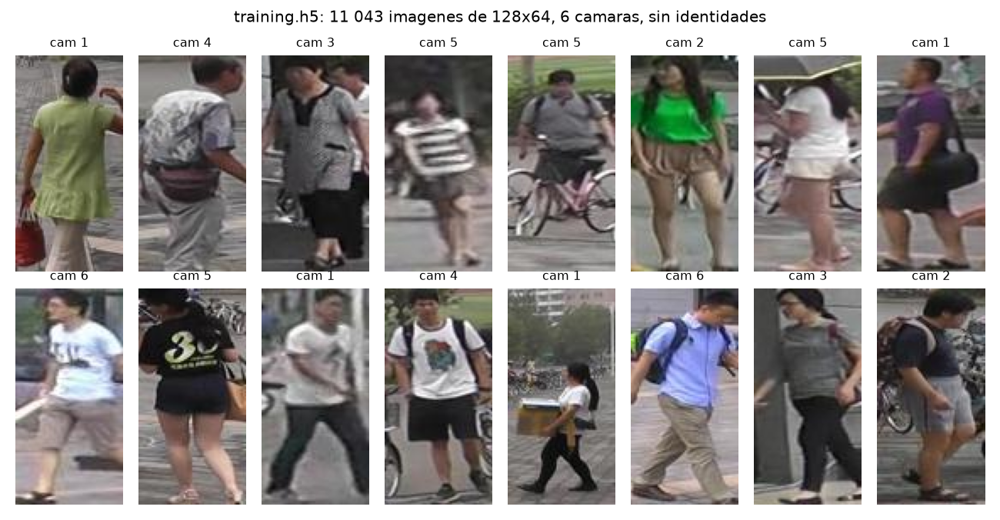
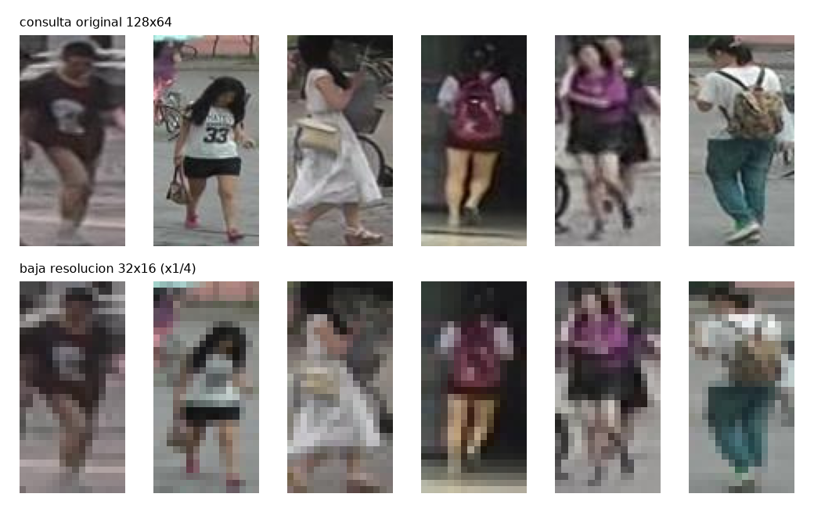
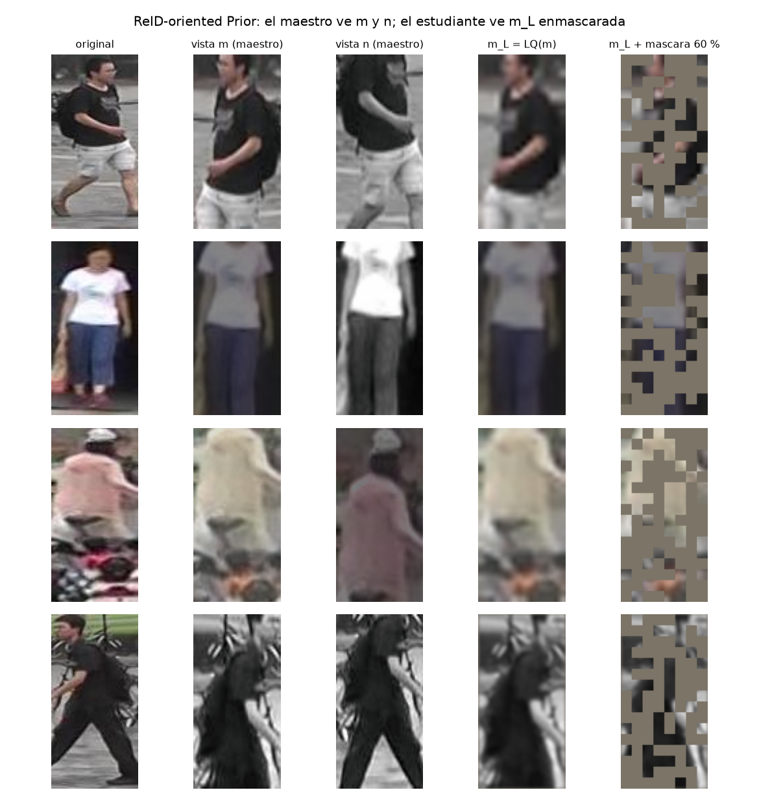
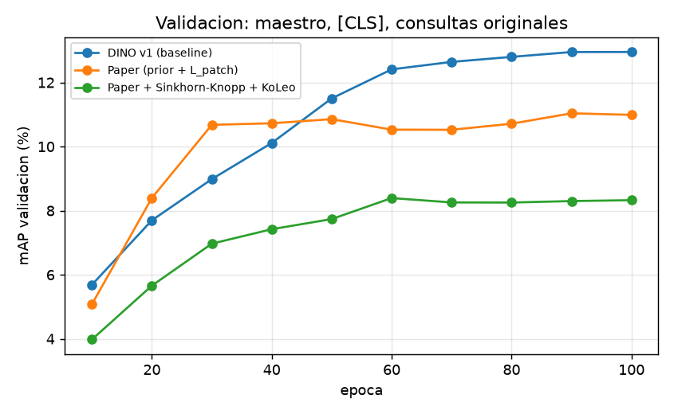
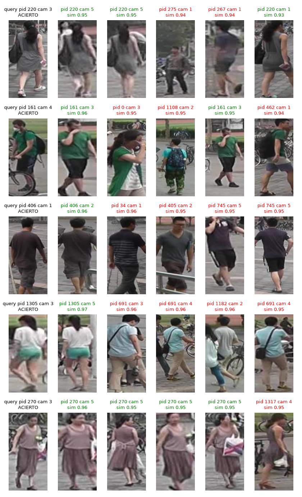
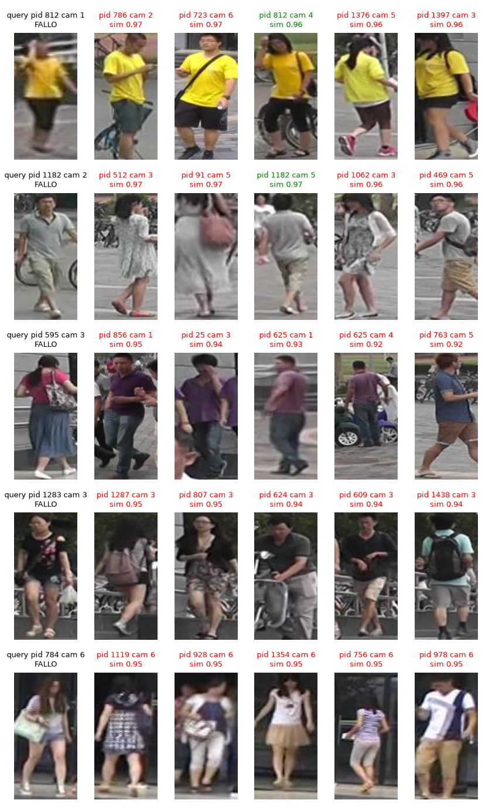
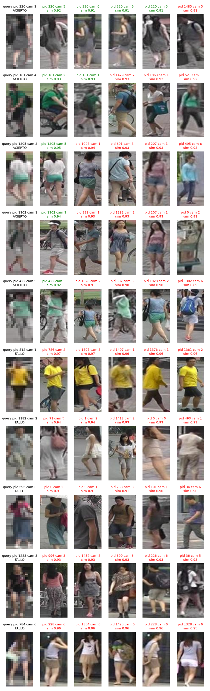

# Metodología

## Encontrar a la misma persona en otra cámara

::: {.columns}
::: {.column width="55%"}
- Entrada: una imagen de **consulta** de 128×64 píxeles.
- Salida: la **galería ordenada** por similitud coseno del embedding.
- **Sin etiquetas de identidad** durante el entrenamiento.
- Dos condiciones de prueba: consultas originales y a **1/4 de resolución**.
- Implementamos Yang et al. (2025, *The Visual Computer*): DINO con un prior orientado a ReID.
:::

::: {.column width="45%"}
<div class="metric">
<strong>11 043</strong>
imágenes de entrenamiento, 6 cámaras
</div>

<div class="metric">
<strong>3 368 → 19 732</strong>
consultas y galería de test
</div>

<div class="metric">
<strong>mAP · Rank-1/5/10</strong>
protocolo Market-1501
</div>
:::
:::

::: {.notes}
(≈50 s) Presentar la tarea de recuperación: dado un recorte de persona, ordenar la galería. Remarcar que
las personas de test no aparecen en entrenamiento y que no se usan identidades para entrenar.
:::

## El dataset: Market-1501

{.r-stretch fig-alt="Dieciséis imágenes de entrenamiento con su cámara."}

::: {.compact}
Recortes de 128×64 de seis cámaras en un campus. Validación: 100 consultas y 1 793 imágenes de galería,
con identidades solo para medir. Test: 750 identidades distintas a las de entrenamiento.
:::

::: {.notes}
(≈40 s) Mostrar la variedad: cambios de pose, fondo, iluminación y cámara. Los recortes son pequeños y
muchos están desenfocados.
:::

## ¿Por qué es difícil?

::: {.columns}
::: {.column width="48%"}
{fig-alt="Consultas originales y a un cuarto de resolución."}
:::

::: {.column width="52%"}
- La misma persona cambia de **punto de vista, fondo y escala** entre cámaras.
- Las consultas de baja resolución son de **32×16**: se pierde el detalle de ropa y accesorios.
- Personas distintas con **ropa parecida** se confunden fácilmente.
- No hay identidades: el modelo tiene que descubrir solo qué es invariante.
:::
:::

::: {.key-message}
El embedding debe ser invariante a la cámara y robusto a la pérdida de resolución, sin ver ninguna etiqueta.
:::

::: {.notes}
(≈45 s) Conectar con el paper: su motivación es exactamente la baja calidad de las cámaras de vigilancia
y las oclusiones.
:::

## Punto de partida: DINO v1

```{mermaid}
%%| fig-width: 11
%%| fig-height: 4
flowchart LR
    X["imagen x"] --> M["vista m"]
    X --> N["vista n"]
    M --> S["estudiante S<br/>(backprop)"]
    N --> T["maestro T<br/>(EMA de S)"]
    S --> PS["proyector → softmax(·/τs)"]
    T --> PT["proyector → centering → softmax(·/τt)"]
    PT -.->|"objetivo"| L["cross-entropy"]
    PS --> L
```

::: {.compact}
Dos redes idénticas. El estudiante se entrena por gradiente; el maestro es una **media móvil exponencial**
del estudiante. El maestro produce una distribución sobre $K$ prototipos que el estudiante debe imitar.
**Centering** (restar una media móvil) y **sharpening** (temperatura baja) evitan el colapso.
:::

::: {.notes}
(≈50 s) Explicar por qué no colapsa: el centering impide que un prototipo domine; el sharpening impide la
distribución uniforme. No hay negativos ni etiquetas.
:::

## Lo que agrega el paper: ReID-oriented Prior

{.r-stretch fig-alt="Original, vistas aumentadas, versión de baja calidad y versión enmascarada."}

::: {.compact}
El **maestro** ve las vistas limpias $(m_O, n_O)$. El **estudiante** ve una versión degradada: **LQ** (blur
gaussiano σ = 1 y motion blur L = 3) y **RM** (60 % de los tokens reemplazados por un token de máscara).
:::

::: {.notes}
(≈50 s) Este es el núcleo del paper. Simula las dos dificultades reales: baja calidad de imagen y
oclusión. El estudiante tiene que "restaurar" en el espacio de embeddings lo que el maestro ve completo.
:::

## Dos proyectores, dos pérdidas

::: {.columns}
::: {.column width="55%"}
$$
\mathcal{L}_{patch}(m_O, m_L, m_R) = -\sum_{i=1}^{N} f^{T}_{patch}(T(m^i_O))^{\top} \log f^{S}_{patch}(S(m^i_L, m^i_R))
$$

$$
\mathcal{L}_{[CLS]}(m_O, n_L, n_R) = -f^{T}_{[CLS]}(T(m_O))^{\top} \log f^{S}_{[CLS]}(S(n_L, n_R))
$$

$$
\mathcal{L}_{pre} = \mathcal{L}_{patch}(m) + \mathcal{L}_{patch}(n) + \lambda\,[\mathcal{L}_{[CLS]}(m_O, n) + \mathcal{L}_{[CLS]}(n_O, m)]
$$
:::

::: {.column width="45%"}
- **Patch, misma vista**: cada token degradado del estudiante imita al token limpio del maestro.
- **[CLS], vista cruzada**: la imagen global de $n$ debe coincidir con la de $m$ (como DINO).
- Un solo proyector con **pesos compartidos** entre [CLS] y patches (§4.1.2).
- $\lambda = 0.55$.
:::
:::

::: {.key-message}
La pérdida de patches restaura detalle local; la de [CLS] alinea la semántica global entre vistas.
:::

::: {.notes}
(≈1 min) Señalar que la pérdida de patches es la de iBOT; la de [CLS], la de DINO. El paper las combina
con el prior. El proyector es un MLP de tres capas, normalización L2 y una capa de prototipos.
:::

## Nuestra ablación: dos ideas de DINOv2

::: {.columns}
::: {.column width="50%"}
**Sinkhorn-Knopp en vez de centering**

- El maestro produce una matriz $Q$ (imágenes × prototipos) **doblemente estocástica**.
- Tres iteraciones de normalización alternada de filas y columnas.
- Obliga a repartir el batch en partes iguales entre los prototipos.
:::

::: {.column width="50%"}
**Regularizador KoLeo**

$$
\mathcal{L}_{koleo} = -\frac{1}{B}\sum_{i} \log\, d_{nn}(x_i)
$$

- $d_{nn}$: distancia al vecino más cercano del batch.
- Maximiza la entropía diferencial: separa los embeddings.
- Peso 0.1, como en DINOv2.
:::
:::

::: {.notes}
(≈45 s) La hipótesis: un reparto más uniforme de los prototipos y embeddings más separados deberían
ayudar a distinguir personas parecidas. Lo verificamos como ablación.
:::

# Implementación

## Del paper al laboratorio

::: {.small}
| Paper | Este trabajo | Motivo |
|---|---|---|
| Pre-entrena en LUPerson (4.18 M imágenes) | 11 043 imágenes de Market-1501 | Dato del laboratorio |
| ViT-S/16 a 256×128 | **ViT-S/8 a 128×64** (mismos 128 tokens) | No reescalar: no hay información que ganar |
| LQ = blur gaussiano + motion blur | LQ + **reducción ×4** bicúbica (p = 0.5) | La evaluación usa consultas a 1/4 |
| Fine-tuning supervisado con triplet loss | **Sin fine-tuning**: embedding = token [CLS] del backbone, L2 + coseno | El lab prohíbe identidades |
| Pérdida de patches sobre $N$ tokens (Ec. 1) | Igual, sobre todos los tokens | Los visibles también están degradados |
| 4 × V100, batch 256 | 1 × RTX A2000 12 GB, batch 128, bf16 | lr escalado: 5e-4 · 128/256 |
:::

::: {.notes}
(≈1 min) Lo más importante: sin LUPerson y sin fine-tuning, evaluamos el pre-entrenamiento en crudo. El
paper nunca reporta ese número. Y agregamos la reducción ×4 al prior porque es la condición de test.
:::

## La arquitectura, en 150 líneas

::: {.columns}
::: {.column width="50%"}
**`reid/model.py`**

- `ViT`: conv 8×8 → 128 tokens + [CLS], 12 bloques pre-norm de 384-d y 6 cabezas, **token de máscara** aprendible. 21.4 M parámetros.
- `Head`: MLP 384 → 2048 → 2048 → 256, L2, prototipos $K = 4096$ con pesos normalizados.

**`reid/prior.py`**

- `gaussian_blur`, `motion_blur` (ángulo aleatorio por imagen), `downsample`, `random_mask`.
:::

::: {.column width="50%"}
**`reid/loss.py`**

- `DistillLoss`: centering EMA (0.9) o `sinkhorn_knopp`; cross-entropy maestro → estudiante.
- `koleo`.

**`train.py`**

- Un `Head` por red; el mismo módulo se aplica a `tokens[:, 0]` y a `tokens[:, 1:]`.
- `t_cls.roll(b)` cruza las vistas para la pérdida [CLS].
- Maestro: `p_t.lerp_(p_s, 1 − m)` tras cada paso.
:::
:::

::: {.notes}
(≈1 min) Todo es propio: ViT, prior, proyector y pérdidas. Solo usamos `nn.TransformerEncoderLayer` como
bloque. Destacar el proyector compartido y el roll que implementa la vista cruzada.
:::

## Cómo entrenamos

::: {.columns}
::: {.column width="50%"}
- AdamW, lr 2.5e-4 (5e-4 · 128/256), weight decay 0.04.
- 10 épocas de warmup lineal y decaimiento coseno a 1e-6.
- **100 épocas**, 86 pasos por época, ~65 s por época en una RTX A2000.
- Temperatura del maestro 0.04 → 0.07 en 30 épocas; estudiante 0.1.
- Momentum del maestro 0.996 → 1 (coseno).
:::

::: {.column width="50%"}
- Clip de gradiente 3.0; prototipos congelados en la primera época (truco de DINO).
- Aumentaciones por vista: recorte aleatorio (50–100 %), flip, color jitter, escala de grises, solarización.
- bf16 con autocast; 9.5 GB de VRAM.
- Validación cada 10 épocas con el maestro.
:::
:::

::: {.key-message}
Cada run cuesta 1.8 horas. Con el plazo, priorizamos tres runs y una cuarta configuración del prior.
:::

::: {.notes}
(≈45 s) Hiperparámetros de DINO con el lr escalado por batch. 8 600 pasos en total: muy pocos comparados
con los 1.5 M de DINO en ImageNet.
:::

## Cómo evaluamos

- Embedding: token **[CLS]** del backbone, normalizado L2; similitud **coseno**.
- Protocolo Market-1501: se descartan las imágenes de galería con la **misma identidad y misma cámara**
  que la consulta; las marcadas como *junk* (−1) se ignoran; los distractores (0) cuentan como negativos.
- **mAP** y **Rank-1/5/10** sobre las 3 368 consultas de test.
- Dos condiciones con el **mismo modelo**: consultas originales y a 32×16 (reescaladas bicúbicamente a 128×64 antes de la red).
- Reportamos **maestro y estudiante**.

::: {.notes}
(≈40 s) La baja resolución entra reescalada a 128×64; el backbone no cambia. La caída de mAP entre
condiciones mide la robustez.
:::

## ¿Qué comparamos?

::: {.small}
| Run | Prior (LQ + RM) | $\mathcal{L}_{patch}$ | Objetivo del maestro | KoLeo | Pregunta |
|---|---|---|---|---|---|
| ViT sin entrenar | – | – | – | – | Piso de referencia |
| **DINO v1** (modelo base) | no | no | centering | no | ¿Qué aporta el paper sobre DINO? |
| **Paper** | sí (máscara 60 %, ×1/4 p = 0.5) | sí | centering | no | Método completo |
| Paper + DINOv2 (ablación) | sí | sí | **Sinkhorn-Knopp** | **0.1** | ¿Ayudan las mejoras de DINOv2? |
| Paper, prior suave | máscara **30 %**, sin ×1/4 | sí | centering | no | ¿Es demasiado agresivo el prior? |
:::

::: {.key-message}
Mismo backbone, mismos hiperparámetros y mismas 100 épocas en todos los runs; solo cambia lo indicado.
:::

::: {.notes}
(≈40 s) El modelo base es DINO v1 puro: apagar el prior y la pérdida de patches en el mismo código. Así
la comparación aísla exactamente la contribución del paper.
:::

# Resultados

## Resultados en test (maestro)

::: {.small}

:::

::: {.compact}
LR = consultas a 1/4 de resolución. Los valores están en porcentaje.
:::

::: {.notes}
(≈1 min) Leer la tabla con calma. Primero el piso: un ViT sin entrenar da 0.6 de mAP.
DINO llega a 3.0 y el paper a 2.1. Todos aprenden, pero poco.
:::

## Qué vemos

::: {.columns}
::: {.column width="55%"}
{fig-alt="mAP de validación por época para cada run."}
:::

::: {.column width="45%"}
- Todos los modelos superan al ViT sin entrenar (0.6 mAP) por un factor de 3 a 5.
- **DINO v1** es el mejor en consultas originales: 3.0 mAP, R1 8.2.
- El **paper** con el prior completo queda en 2.1 mAP, R1 5.9.
- La curva de validación de DINO sigue subiendo al final: faltan pasos.
:::
:::

::: {.key-message}
Con 11 k imágenes y 8 600 pasos, un ViT desde cero aprende, pero está lejos de converger.
:::

::: {.notes}
(≈50 s) Explicar el régimen: el paper pre-entrena con 4 M de imágenes; nosotros con el 0.3 % de eso.
La curva de DINO no se aplana. El prior hace la tarea del estudiante más difícil y con tan pocos pasos
eso cuesta.
:::

## Baja resolución: la caída de mAP

::: {.small}
| Modelo (maestro) | mAP original | mAP a 1/4 | Caída | Caída relativa |
|---|---:|---:|---:|---:|
| DINO v1 | 3.0 | 1.9 | 1.1 | 36 % |
| Paper | 2.1 | 1.7 | 0.4 | 18 % |
| Paper + DINOv2 | @@paper_dinov2.teacher.original.mAP@@ | @@paper_dinov2.teacher.low_res.mAP@@ | @@paper_dinov2.teacher.drop@@ | @@paper_dinov2.teacher.drop_rel@@ % |
| Paper, prior suave | @@paper_soft.teacher.original.mAP@@ | @@paper_soft.teacher.low_res.mAP@@ | @@paper_soft.teacher.drop@@ | @@paper_soft.teacher.drop_rel@@ % |
:::

::: {.key-message}
El prior cumple su promesa en robustez: el paper pierde una fracción menor de su mAP al bajar la
resolución que DINO. Pero parte de un nivel más bajo.
:::

::: {.notes}
(≈50 s) Esta es la evidencia a favor del paper: el estudiante entrenado con LQ y máscara es menos
sensible a la resolución. La pregunta es si vale el costo en precisión con consultas limpias.
:::

## Ablación: Sinkhorn-Knopp y KoLeo

::: {.small}
| Modelo (maestro) | mAP | R1 | mAP (LR) | mAP validación (ép. 100) |
|---|---:|---:|---:|---:|
| Paper (centering) | 2.1 | 5.9 | 1.7 | 11.0 |
| Paper + Sinkhorn-Knopp + KoLeo | @@paper_dinov2.teacher.original.mAP@@ | @@paper_dinov2.teacher.original.R1@@ | @@paper_dinov2.teacher.low_res.mAP@@ | @@paper_dinov2.val.mAP@@ |
:::

::: {.compact}
- Sinkhorn-Knopp reparte 11 k imágenes en 4 096 prototipos por igual: **≈ 3 imágenes por prototipo**.
- KoLeo separa los embeddings del batch aunque sean de la misma persona.
:::

::: {.key-message}
Las mejoras de DINOv2 están pensadas para cientos de millones de imágenes; con 11 k, forzar uniformidad no ayuda.
:::

::: {.notes}
(≈1 min) Un resultado negativo también es un resultado. Explicar el mecanismo: la restricción de
igualdad de partición es demasiado fuerte cuando hay menos imágenes que "slots" significativos, y KoLeo
penaliza la cercanía que justamente queremos entre vistas de una misma persona.
:::

## ¿Es demasiado agresivo el prior?

::: {.small}
| Modelo (maestro) | mAP | R1 | mAP (LR) | Caída | mAP validación (ép. 100) |
|---|---:|---:|---:|---:|---:|
| DINO v1 | 3.0 | 8.2 | 1.9 | 1.1 | 13.0 |
| Paper, máscara 60 % + ×1/4 | 2.1 | 5.9 | 1.7 | 0.4 | 11.0 |
| Paper, máscara 30 %, sin ×1/4 | @@paper_soft.teacher.original.mAP@@ | @@paper_soft.teacher.original.R1@@ | @@paper_soft.teacher.low_res.mAP@@ | @@paper_soft.teacher.drop@@ | @@paper_soft.val.mAP@@ |
:::

::: {.compact}
- El paper eligió 60 % de máscara con 4 M de imágenes; su Figura 5 muestra que 30 % rinde casi igual.
- Con un estudiante débil, ver el 40 % de los patches borrosos y además reducidos es una tarea muy dura.
:::

::: {.notes}
(≈50 s) La intensidad del prior es un hiperparámetro ligado al tamaño del dataset. Comentar el resultado
según la tabla: si el prior suave acerca o supera a DINO, el mecanismo funciona pero estaba mal calibrado.
:::

## Maestro frente a estudiante

::: {.small}

:::

::: {.compact}
En DINO el maestro suele ser mejor; aquí el estudiante de DINO lo supera ligeramente y el del paper queda por
debajo de su maestro: el estudiante del paper nunca vio una imagen limpia durante el entrenamiento.
:::

::: {.notes}
(≈40 s) El lab pide comparar ambos. La diferencia es pequeña. En el paper el estudiante entrena con
imágenes degradadas y se evalúa con limpias: ese desajuste explica la brecha.
:::

## Aciertos

{.r-stretch fig-alt="Cinco consultas con su top-5 de galería, acertadas."}

::: {.notes}
(≈40 s) Verde: misma identidad. Los aciertos son personas con ropa de color saturado o un accesorio
distintivo (mochila, bolso), visibles desde cualquier cámara.
:::

## Fallos

{.r-stretch fig-alt="Cinco consultas con su top-5 de galería, falladas."}

::: {.compact}
Los vecinos recuperados comparten **color de ropa y pose** con la consulta: el embedding codifica apariencia
global, no identidad. Ropa oscura y fondos parecidos producen los fallos más sistemáticos.
:::

::: {.notes}
(≈45 s) Rojo: identidad distinta. Las similitudes son altas (> 0.9) incluso en los fallos: el espacio es
poco discriminativo. Mencionar también las consultas de baja resolución, donde se pierden los detalles
finos y solo queda el color.
:::

## Limitaciones

- **Datos**: 11 k imágenes contra 4.18 M del paper; sin LUPerson el ViT no alcanza a converger en 100 épocas.
- **Sin fine-tuning**: evaluamos el pre-entrenamiento en crudo; el paper siempre ajusta con identidades.
- **Validación pequeña**: 100 consultas; una diferencia de 2 puntos de mAP equivale a dos consultas.
- **Una semilla por run**: no medimos la varianza entre corridas.
- **Prior calibrado para otro régimen**: máscara 60 % y reducción ×4 son demasiado para un estudiante desde cero.
- **Dos vistas globales**, sin multi-crop: DINO depende de las vistas locales para rendir.

## Conclusiones

::: {.compact}
1. Implementamos el método completo desde cero: ViT con token de máscara, ReID-oriented Prior, proyector compartido y las pérdidas de [CLS] y patches con destilación por EMA.
2. Con el mismo código apagamos el prior y la pérdida de patches para obtener DINO v1 como modelo base.
3. En test, DINO v1 obtiene 3.0 mAP y el paper 2.1; ambos muy por encima del ViT sin entrenar (0.6).
4. El prior reduce la caída por baja resolución (0.4 frente a 1.1 puntos), pero cuesta precisión con consultas limpias.
5. Sinkhorn-Knopp y KoLeo (DINOv2) dan @@paper_dinov2.teacher.original.mAP@@ mAP: no ayudan con 11 k imágenes.
6. Un prior más suave da @@paper_soft.teacher.original.mAP@@ mAP: la intensidad del prior depende del tamaño del dataset.
:::

::: {.key-message}
El mecanismo del paper hace lo que promete, robustez a la degradación, pero necesita muchos más datos y
pasos de los que tenemos para traducirse en precisión.
:::

## Apéndice: configuración completa {.smaller visibility="uncounted"}

| Etapa | Valor |
|---|---|
| Backbone | ViT-S/8: 384-d, 6 cabezas, 12 bloques pre-norm, 128 tokens + [CLS], 21.4 M params |
| Proyector | MLP 384 → 2048 → 2048 → 256, GELU, L2, prototipos K = 4096 normalizados, compartido [CLS]/patch |
| Prior | Blur gaussiano σ = 1 (k = 5), motion blur L = 3 con ángulo U(0, 2π), reducción ×4 bicúbica p = 0.5, máscara 60 % |
| Aumentaciones | RandomResizedCrop (0.5–1), flip, ColorJitter(0.4, 0.4, 0.2, 0.1) p = 0.8, gris p = 0.2, solarización p = 0.2 |
| Pérdida | L_patch + 0.55·L_cls; τ_s = 0.1; τ_t 0.04 → 0.07 en 30 épocas; centering EMA 0.9 o Sinkhorn-Knopp (3 it.) |
| Optimización | AdamW lr 2.5e-4, wd 0.04, warmup 10, coseno a 1e-6, clip 3.0, batch 128, 100 épocas, bf16 |
| Maestro | EMA con momentum 0.996 → 1 (coseno); prototipos del estudiante congelados en la época 1 |
| Evaluación | [CLS] L2 + coseno; protocolo Market-1501; consultas 32×16 reescaladas a 128×64 |

## Apéndice: código de la implementación {.smaller visibility="uncounted"}

| Componente | Archivo y símbolo |
|---|---|
| ViT con token de máscara | `reid/model.py::ViT` |
| Proyector compartido [CLS]/patch | `reid/model.py::Head` |
| Blur gaussiano, motion blur, reducción ×4 | `reid/prior.py::gaussian_blur`, `motion_blur`, `downsample` |
| Máscara aleatoria | `reid/prior.py::random_mask` |
| Centering + sharpening, cross-entropy | `reid/loss.py::DistillLoss` |
| Sinkhorn-Knopp | `reid/loss.py::sinkhorn_knopp` |
| KoLeo | `reid/loss.py::koleo` |
| Vistas m y n, aumentaciones | `reid/data.py::TwoViews` |
| Bucle maestro–estudiante y EMA | `train.py::main` |
| Protocolo Market-1501 | `reid/metrics.py::evaluate` |
| Extracción y dos condiciones | `evaluate.py::extract`, `run` |

## Apéndice: curvas de validación {visibility="uncounted"}

{.r-stretch fig-alt="mAP de validación por época para cada run."}

## Apéndice: aciertos y fallos con consultas de baja resolución {visibility="uncounted"}

{.r-stretch fig-alt="Top-5 con consultas de baja resolución."}
